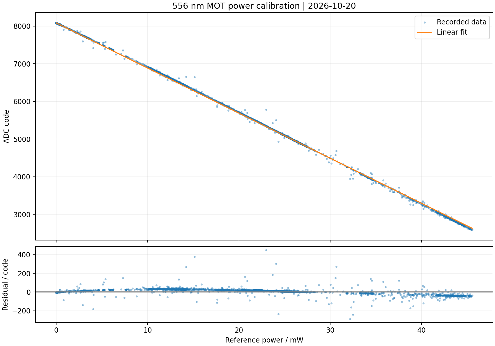

# 20261020adc数字码和主光路功率关系拟合

556 nm MOT 单束光：参考功率计、AD9248 / FPGA 数字码的实时采集、散点、线性拟合与原始实验数据。归档日期 2026-10-20。

## 内容与启动

- `fpga/`：独立标定固件、板级引脚约束、Vivado 构建脚本；`fpga/build/mot556_calibration.bit` 为本次使用的固件。
- `host/`：电脑 Tkinter / matplotlib 界面；双击 `launch.cmd`，或执行 `python host/app.py`。
- `data/`：本次 20 个真实采集会话（包括早期未得到有效配对点的会话），共 13381 行已记录点。会话间可能有导入的重复点，不能把总行数当独立测量数。
- `raw.jsonl.gz`：完整行原始采集日志的 gzip 压缩文件，可用 Python gzip 或 7-Zip 打开。
- `calibration.json`：最后会话 20261020_153506_595958_REAL 的 10289 个点重新计算的拟合；`fit.png` 是对应图。

安装 Python 依赖：`python -m pip install -r requirements.txt`。真实功率计需安装 Thorlabs 64 位 TLPMX 驱动，并使用 64 位 Python；FPGA 串口为 115200 / 8N1。当前设备是 PM100USB，序列号 P2007293，波长 556 nm；界面可改序列号和 COM 口。

软件连续记录配对点，**不设稳定性阈值**。按电脑接收时间找最近 ADC 帧，最多允许 0.2 s 配对偏差；CRC、过量程和过期数据检查仍保留。USB 接收时间配对不等于硬件同步。功率漂移可记录，但快速变化可能引入配对误差。

## 本次拟合

`C = (-119.760506946) × P[mW] + (8083.31476076)`

- R² = 0.99984641148
- RMSE = 17.2060029 code（折合约 0.1437 mW 的拟合残差）
- 功率数据范围约 0–45.536507 mW，微小负读数保留在原始数据中。
- `C` 是候选 0 的 `raw XOR 0x2000` 码。PID 工程内部码定义相反，必须用 `C=16383-y` 后再换算。

快照时间为 2026-10-20T08:11:21.514971+00:00。采集程序随后新增的数据不在这份不可变快照中。各会话 metadata 保留实验时配置；部分历史设置已被之后的软件版本替代。

此拟合仅适用于本次分光比例、探测器增益、连接和通道；显示四位小数不是四位小数的测量精度。不要用该直线外推校准范围。

